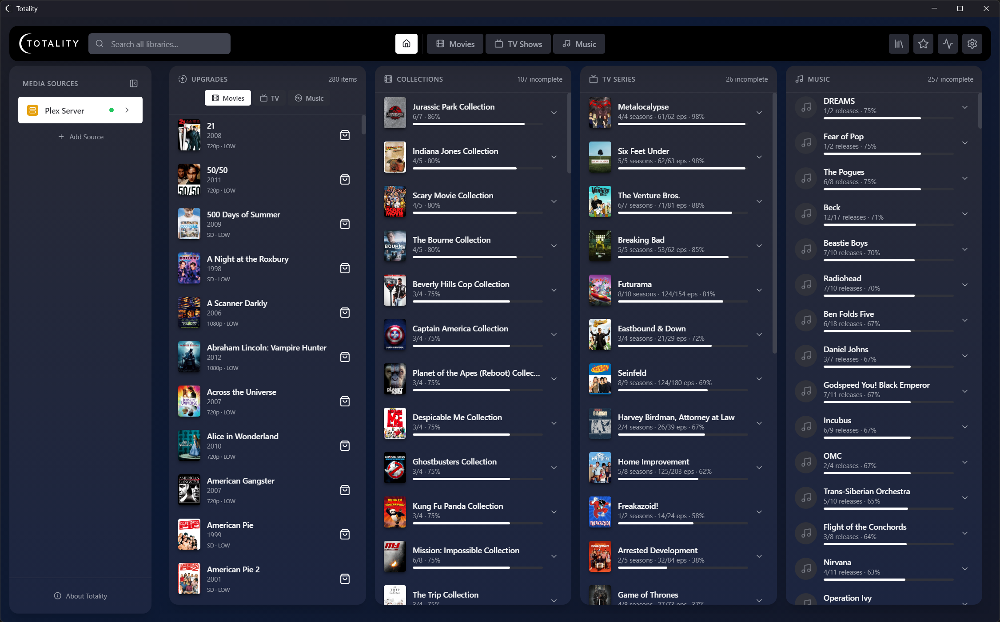
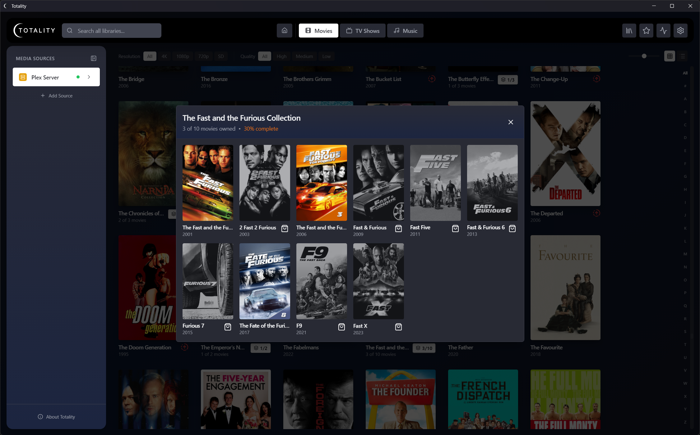
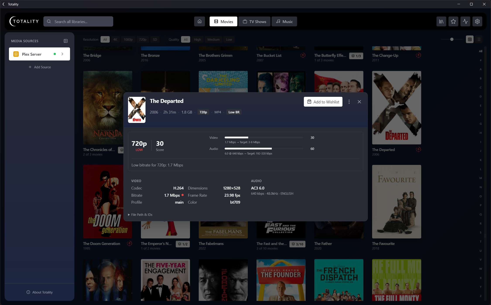
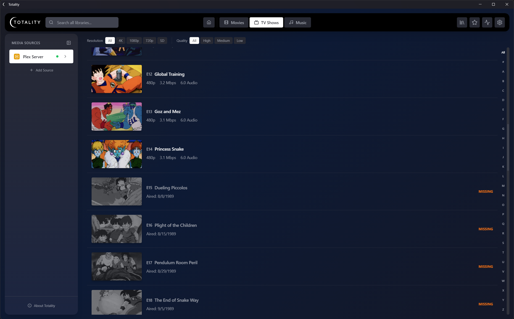
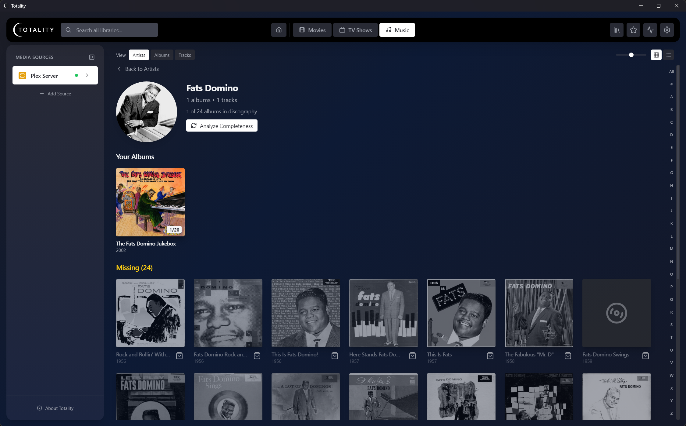
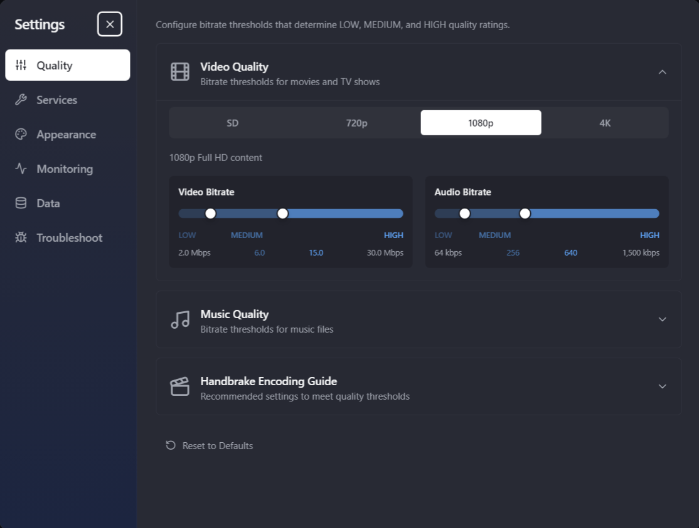
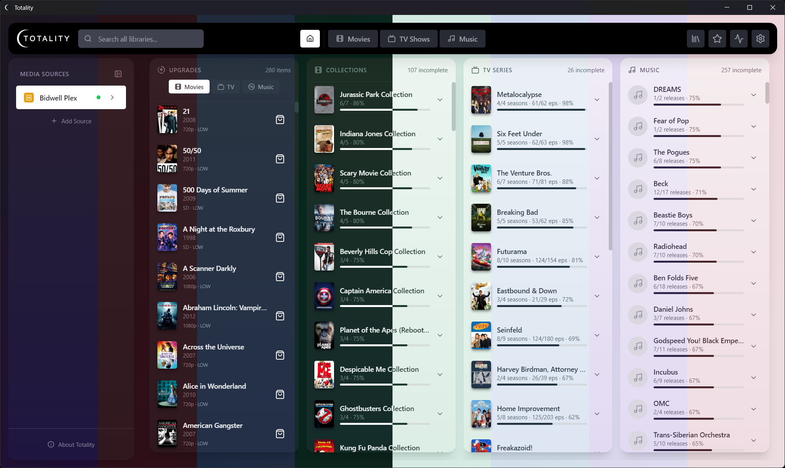

# Totality

A desktop application for analyzing and managing your media library quality across multiple media servers and local folders. Includes mobile web access for browsing your library on the go.

Totality connects to your media servers (Plex, Jellyfin, Emby, Kodi, MediaMonkey) and local folders to provide detailed quality analysis of your movies, TV shows, and music. It helps you identify items that could be upgraded to higher quality versions, tracks your collection completeness, and maintains a wishlist of media you want to acquire.

## Screenshots

### Dashboard
Track upgrades, incomplete collections, TV series, and music discographies at a glance.



### Movie Collections
See which movies you own in a franchise and which ones are missing.



### Quality Analysis
Detailed quality breakdown for each item — resolution, bitrate, codec, audio format, and scoring.



### TV Series Completeness
Track owned and missing episodes across all seasons with TMDB integration.



### Music Library
Browse artists, albums, and tracks with MusicBrainz discography completeness.



### Settings
Configure quality thresholds, API keys, monitoring intervals, and appearance.



### Themes
A wide variety of dark and light themes to match your style.



## Features

### Multi-Source Support

Connect to multiple media sources simultaneously:
- **Plex** — Full support with OAuth authentication (owned servers only — shared servers are filtered)
- **Jellyfin** — Full support with server discovery (UDP broadcast)
- **Emby** — Full support with server discovery
- **Kodi** — Local database access, JSON-RPC, and MySQL backend support
- **MediaMonkey** — Read-only scan of MM4/MM5 databases (music only)
- **Local Folders** — Direct folder scanning with FFprobe analysis and TMDB/MusicBrainz metadata lookup

### Video Quality Analysis

Automatically analyzes your movies and TV shows for:
- **Resolution** — SD, 720p, 1080p, 4K with quality tier scoring
- **HDR Format** — Dolby Vision, HDR10, HDR10+, HLG
- **Color Depth** — 8-bit, 10-bit, 12-bit
- **Video Bitrate** — With codec efficiency multipliers (H.264, HEVC, AV1, VP9)
- **Audio Format** — Dolby Atmos, DTS:X, TrueHD, DTS-HD MA, and more
- **Quality Issues** — Identifies low bitrate, missing HDR, suboptimal audio

#### Quality Scoring System

Items are scored within tiers (SD/720p/1080p/4K) as LOW, MEDIUM, or HIGH based on:
- Video bitrate relative to resolution
- Codec efficiency (AV1 > HEVC > H.264)
- Audio codec quality ranking
- Configurable video/audio weight (default 70/30)

### Music Quality Analysis

Analyzes audio tracks with a five-tier quality rating system:

| Tier | Description | Criteria |
|------|-------------|----------|
| **Ultra** | Hi-Res Lossless | Lossless codec (FLAC/ALAC/WAV) with 24-bit+ depth OR >48kHz sample rate |
| **High** | CD-Quality Lossless | Lossless codec at 16-bit / 44.1-48kHz |
| **High Lossy** | High-Quality Lossy | Lossy codec at 256+ kbps |
| **Medium** | Transparent Lossy | MP3 >=160 kbps or AAC >=128 kbps |
| **Low** | Low Bitrate Lossy | MP3 <160 kbps or AAC <128 kbps |

### Completeness Tracking

#### TV Series (TMDB Integration)
- Shows missing episodes per season
- Displays series status (Returning, Ended, Canceled)
- Tracks overall collection completeness percentage
- Optional empty season exclusion

#### Movie Collections (TMDB Integration)
- Groups movies by franchise using TMDB's collection data
- Shows owned vs missing movies in collections
- Configurable theatrical release lag for new movies

#### Music (MusicBrainz Integration)
- Analyzes artist discographies
- Shows owned vs missing albums
- Tracks album completeness (missing tracks)
- Filters to digital/CD releases only (excludes vinyl-only releases)
- Configurable EP and singles tracking

#### Filmography (TMDB Integration)
- Track directors, actors, writers, composers, cinematographers, editors
- Shows owned vs missing movies per person
- Completeness percentage per person

### Mobile & Web Access

Browse your library from any device on your network:
- **HTTPS web server** with PIN authentication and encrypted sessions
- **Real-time sync** — scans, progress, and library updates pushed via WebSocket
- **PWA support** — add to home screen on iOS/Android for app-like experience
- **Deep linking** — bookmark and share links to specific views
- **Mobile scan UI** — trigger and monitor library scans from mobile
- **Barcode scanner** — scan UPC/EAN codes to quickly add items to your wishlist

### Tag Sync (Mood/Genre)

Bidirectional sync of mood and genre tags across media sources:
- **Supported sources** — Plex, MediaMonkey, Kodi
- **Modes** — Overwrite or append tags
- **Per-track control** — Review and selectively sync individual tracks
- **Source of truth** — Choose which source has the canonical tags

### Local Folder Scanning

Scan local media folders without a media server:
- **FFprobe Integration** — Extracts resolution, codecs, bitrate, HDR info, audio tracks
- **Auto-download FFprobe** — Downloads FFprobe binaries automatically on Windows
- **Smart Filename Parsing** — Extracts title, year, season/episode from filenames
- **Embedded Metadata** — Reads MKV/MP4 tags for accurate metadata
- **TMDB Lookup** — Fetches missing metadata from TMDB
- **Extras Filtering** — Automatically excludes featurettes, trailers, behind-the-scenes content

### Wishlist / Shopping List

Track media you want to acquire:
- Add movies, TV shows, albums to your wishlist
- Set priority levels and add notes
- Search external stores (Amazon, iTunes, etc.) for purchase options
- **Barcode scanner** — scan physical media UPCs on mobile to add to wishlist
- **Plex and Trakt watchlist sync** — import and preview before adding
- **Release alerts** — track digital and physical release dates for wishlist items
- Bulk operations and CSV export

### AI Assistant

AI-powered library analysis and recommendations:
- Chat interface with library-aware context
- 29+ tools for querying library data, managing wishlist, searching TMDB
- Streaming report generators (quality, upgrades, completeness, storage)
- Powered by Google Gemini (free tier supported)

### Live Monitoring

Automatic library change detection:
- Polls enabled sources on configurable intervals
- Detects added, updated, and removed items
- Pauses during manual scans
- Real-time notifications of changes
- Upgrade detection notifications

### Background Task Queue

Manage long-running operations:
- Queue multiple scan and analysis tasks
- Pause, resume, and cancel tasks
- Reorder task priority with drag-and-drop
- View task history (completed, failed, cancelled)
- Deduplication prevents duplicate tasks

### Library Views

#### Grid View
- Poster-based display with hover effects
- Adjustable grid scale (7 levels)
- Quality badges on items

#### List View
- Compact list display
- Quality and status badges
- Sortable columns

#### Alphabet Filter
- Quick navigation by first letter
- Special filter for non-alphabetic characters (#)
- Dimmed letters for empty entries

### Search
- Real-time search across all media types
- Searches titles, artists, album names, and series
- Mobile search overlay with category grouping

### Themes

14 built-in themes with dark, light, and system modes:
- Dark, Slate, Ember, Midnight, OLED, Velvet, Emerald, Cobalt, Carbon
- Film-inspired: Matrix, Fury, Gotham, Neon, Whimsy

### Security

- **Credential Encryption** — API keys and passwords encrypted at rest using OS-level encryption (Windows DPAPI, macOS Keychain, Linux libsecret)
- **Context Isolation** — Renderer process isolated from Node.js
- **Web Access Security** — PIN auth, HSTS, CSP headers, encrypted sessions, rate limiting, image proxy SSRF protection

## Getting Started

### Installation

```bash
# Clone the repository
git clone https://github.com/bbidwell85/totality.git
cd totality

# Install dependencies
npm install

# Start development mode
npm run electron:dev

# Build for production
npm run build
```

### Adding a Media Source

1. Click the **+** button in the sidebar under "Sources"
2. Select your source type (Plex, Jellyfin, Emby, Kodi, Local Folder, or MediaMonkey)
3. Follow the authentication/setup flow:
   - **Plex**: Click "Sign in with Plex" to authenticate via browser
   - **Jellyfin/Emby**: Enter server URL and credentials, or use auto-discovery
   - **Kodi**: Select local database or enter MySQL connection details
   - **MediaMonkey**: Auto-discovers MM4/MM5 databases
   - **Local Folder**: Browse to select folder path, choose library type (Movies/TV/Music)
4. Select which libraries to scan

### Scanning Libraries

1. Click the refresh icon next to a library in the sidebar
2. Wait for the scan to complete
3. Progress is shown in the sidebar and task queue panel
4. On mobile, use the scan button in the library header

### Analyzing Completeness

#### For TV Shows and Movies:
1. Click the "Completeness" button in the toolbar
2. Click "Analyze Series" or "Analyze Collections"
3. Wait for the analysis to complete (requires TMDB API key)

#### For Music:
1. Navigate to the Music library
2. Select an artist
3. Click "Analyze Completeness" to check against MusicBrainz
4. View missing albums and tracks

### Mobile Access

1. Go to Settings > Web Access
2. Set a PIN code
3. Enable web access
4. Open the displayed URL on your mobile device
5. Enter the PIN to authenticate
6. Optionally add to home screen for PWA experience

## Configuration

### TMDB API Key
Required for movie/TV completeness analysis and local folder metadata:
1. Go to Settings > Services
2. Enter your TMDB API key
3. Save settings

### Database Location
The SQLite database is stored at:
- **Windows**: `%APPDATA%\totality\totality-v2.db`
- **macOS**: `~/Library/Application Support/totality/totality-v2.db`
- **Linux**: `~/.config/totality/totality-v2.db`

### FFprobe Location
Auto-downloaded to (or manually place at):
- **Windows**: `%APPDATA%\totality\ffprobe\`

## Keyboard Shortcuts

| Shortcut | Action |
|----------|--------|
| `Ctrl/Cmd + F` | Focus search |
| `Escape` | Close modal/panel |
| `G` | Toggle grid view |
| `L` | Toggle list view |
| `Alt + Left` | Navigate back |
| `Alt + Right` | Navigate forward |

## Development

### Project Structure

```
src/
├── main/           # Electron main process
│   ├── services/   # Backend services (Database, API clients, analyzers)
│   ├── providers/  # Media server providers (Plex, Jellyfin, Emby, Kodi, Local, MediaMonkey)
│   ├── database/   # Schema and migrations
│   ├── ipc/        # IPC handlers
│   └── workers/    # Worker threads (FFprobe)
├── preload/        # Preload scripts (IPC bridge)
├── shared/         # Shared types and constants
└── renderer/       # React frontend
    └── src/
        ├── components/  # React components (dashboard, library, mobile, settings, ui, etc.)
        ├── contexts/    # React contexts (Source, Wishlist, Toast, Navigation, Theme)
        ├── hooks/       # Custom hooks
        ├── services/    # Client services (webTransport, hashRouting)
        └── styles/      # CSS styles and design tokens
```

### Commands

```bash
npm run electron:dev     # Start Vite + Electron together (recommended)
npm run build            # TypeScript + Vite + Electron Builder
npm run lint             # Run ESLint (--max-warnings 0)
npm run test             # Run Vitest in watch mode
npm run test:run         # Run all tests once
npm run test:coverage    # Run tests with coverage
npm run release          # Auto-detect version bump from commits
npm run release:patch    # Force patch bump
npm run release:minor    # Force minor bump
```

### Tech Stack

- **Electron** 41 — Desktop framework
- **React** 18 — UI framework
- **TypeScript** — Type safety (strict mode)
- **Vite** 6 — Build tool with HMR
- **Tailwind CSS** 4 — Styling with custom design system
- **better-sqlite3** — SQLite database (WAL mode)
- **ws** — WebSocket server for mobile access
- **selfsigned** — Self-signed TLS certificates
- **html5-qrcode** — Barcode scanning
- **Zod** 4 — Runtime validation
- **react-window** — Virtualized lists for large libraries
- **@dnd-kit** — Drag-and-drop for task queue
- **lucide-react** — Icon library

## API Integrations

- **Plex API** — Media server with OAuth authentication
- **Jellyfin API** — Media server with UDP discovery
- **Emby API** — Media server
- **Kodi JSON-RPC** — Media server (remote)
- **TMDB API** — Movie/TV metadata and collections (rate-limited: 40 req/s)
- **MusicBrainz API** — Music metadata and discographies (rate-limited: 1 req/s)
- **Cover Art Archive** — Album artwork
- **UPCitemdb** — Barcode product lookup
- **Google Gemini** — AI assistant (free tier: 10 RPM)
- **Trakt API** — Watchlist import

## License

MIT License — See LICENSE file for details.
